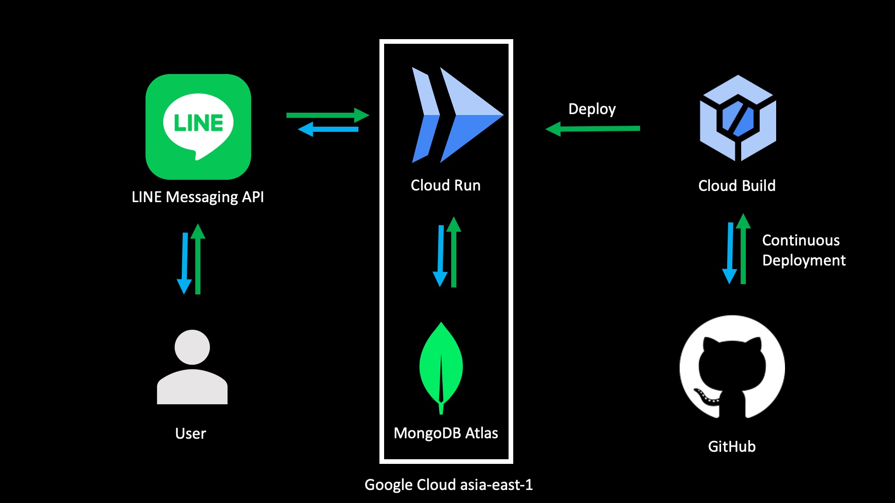

# foodmeow

## Diagram

## Demo

/* TODO */

## Overview & Story

Foodmeow is a spending tracker bot founded on 2020 because of I runaway from home because of education opinion. Weeks later my dad said it would sponsor some expensive especially in meal. Originaly he asked me to create message include this time's amount and accumulated amount, but I felled it is so problematic so I decided to develop a bot because I am on another project [CBFHSS](https://github.com/CBFHSS) and learning on software development.

The beginning of Foodmeow use Django, MySQL on Google Cloud SQL as database and deployed on Heroku. But because of the cost, I decided to migrate to MongoDB Atlas and deployed on Google Cloud Run because it is free, also use the lightwight framework flask.

After years of working in software industry, I started to refactor code to make it to industrial standards, including better structure, clean code and testing. Foodmeow is not just a CRUD and text prompt -- it have more user friendly UX improvement, currency conversion, and maybe more feature in the future.
## How to use

/* TODO */

## Features

- Expense Tracking
  - Add food expenses
  - Add general expenses
  - View unsettled total
  - Delete unsettled total
  - View historical data
  - Exit and delete temporary data

## Contributing

Contributions for new features are welcome!  
As long as the variable names and code are clear, I will review all pull requests ❤️

## Terms of Use

Just provide credit to the source.
